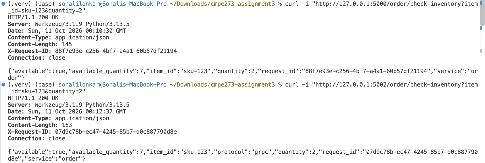
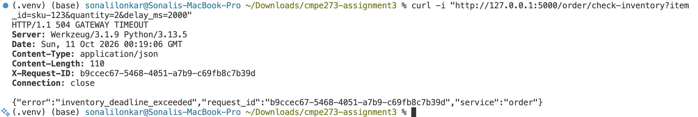
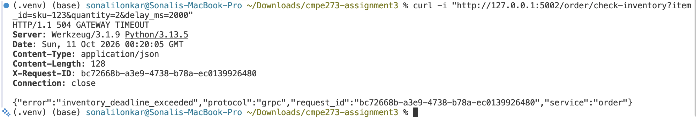
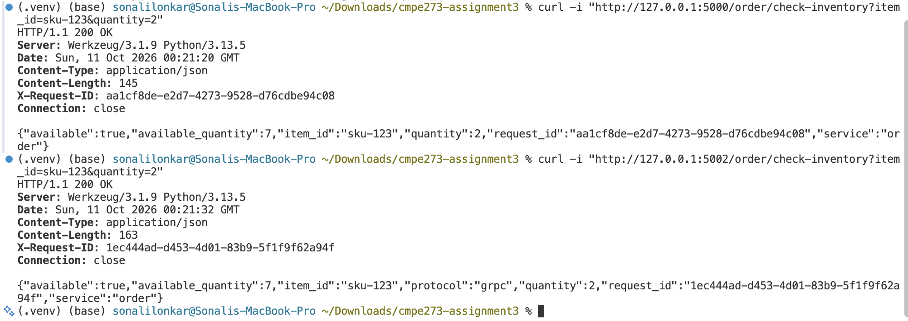

# CMPE 273 Module 3 Assignment: REST and gRPC

This project implements the same Order-to-Inventory interaction using REST/HTTP with JSON and gRPC with Protocol Buffers.

The Order service calls the Inventory service, applies a bounded timeout or deadline, maps downstream failures to an appropriate response, and remains available when Inventory responds too slowly.

## Service architecture

| Version | Order service | Inventory service |
|---|---|---|
| REST | `127.0.0.1:5000` | `127.0.0.1:5001` |
| gRPC-backed HTTP API | `127.0.0.1:5002` | `127.0.0.1:50051` |

The test item is `sku-123`, with seven units available. Both implementations perform the same inventory availability check.

## Submitted evidence files

The following screenshots are included in this repository and referenced below:

| File | Demonstrates |
|---|---|
| `01_successful_rest_and_grpc_requests.png` | Successful REST and gRPC-backed requests returning `200 OK` |
| `02_grpc_deadline_exceeded_504.png` | gRPC deadline exceeded and the resulting `504 Gateway Timeout` |
| `03_rest_timeout_504.png` | REST timeout and the resulting `504 Gateway Timeout` |
| `04_successful_requests_after_failures.png` | Successful requests after the timeout and deadline failures |

## Implementation

### REST

- `rest_order.py` exposes the Order HTTP API.
- `rest_inventory.py` exposes the Inventory HTTP API.
- Requests and responses use JSON.
- The Order service uses a `0.6` second downstream timeout.
- A slow Inventory response is mapped to HTTP `504 Gateway Timeout`.
- An unavailable downstream service is mapped to HTTP `503 Service Unavailable`.

### gRPC

- `proto/inventory.proto` defines the Inventory service contract.
- `grpc_inventory.py` implements the gRPC Inventory server.
- `grpc_order.py` exposes an HTTP endpoint whose downstream call to Inventory uses gRPC.
- The gRPC client uses a `0.6` second deadline.
- `DEADLINE_EXCEEDED` is mapped to HTTP `504 Gateway Timeout`.
- `UNAVAILABLE` is mapped to HTTP `503 Service Unavailable`.

## Successful execution evidence

Both communication paths returned `HTTP/1.1 200 OK` for item `sku-123` and quantity `2`. The responses confirmed that the item was available and that the available quantity was `7`.



The successful responses included unique request IDs for tracing. The gRPC-backed response also included `"protocol":"grpc"`.

## Failure-handling evidence

### REST timeout

The Inventory service was intentionally delayed using `delay_ms=2000`, which is longer than the configured REST timeout. The Order service returned `HTTP/1.1 504 Gateway Timeout` with the error `inventory_deadline_exceeded`.



### gRPC deadline exceeded

The Inventory service was intentionally delayed using `delay_ms=2000`, which is longer than the configured gRPC deadline. The gRPC-backed Order service returned `HTTP/1.1 504 Gateway Timeout` with the error `inventory_deadline_exceeded` and protocol `grpc`.



### Order service remains available

After the REST and gRPC failure tests, the normal requests were sent again. Both services returned `HTTP/1.1 200 OK`, demonstrating that the Order services remained running after their downstream calls exceeded the timeout or deadline.



## Response mapping

| Situation | REST result | gRPC result handled by Order service |
|---|---:|---|
| Available item | `200 OK` | `OK`, returned as `200 OK` |
| Invalid request | `400 Bad Request` | `INVALID_ARGUMENT` |
| Item unavailable | `200 OK` with `available: false` | `OK` with `available: false` |
| Inventory unavailable | `503 Service Unavailable` | `UNAVAILABLE`, mapped to `503` |
| Inventory too slow | `504 Gateway Timeout` | `DEADLINE_EXCEEDED`, mapped to `504` |

## REST versus gRPC comparison

REST uses HTTP and JSON, which makes it easy to test with curl and inspect manually. gRPC uses a typed Protocol Buffers contract and generated bindings, providing a stricter service interface for internal communication. REST communicates failure through HTTP status codes, while gRPC uses statuses such as `UNAVAILABLE` and `DEADLINE_EXCEEDED`; this project maps those gRPC statuses to HTTP responses at the Order API boundary. gRPC requires additional setup because the `.proto` file and generated code must be maintained. Both approaches require explicit timeout or deadline handling because neither protocol alone prevents a slow dependency from affecting the caller.

## Repository contents

- `rest_order.py`: Order HTTP API and REST client.
- `rest_inventory.py`: Inventory HTTP API with injectable delay.
- `grpc_order.py`: HTTP-facing Order API with a gRPC Inventory client.
- `grpc_inventory.py`: gRPC Inventory server with injectable delay.
- `proto/inventory.proto`: gRPC service contract.
- `generated/`: generated Protocol Buffers Python bindings.
- `tests/`: automated success and failure-handling tests.
- `01_successful_rest_and_grpc_requests.png`: successful REST and gRPC evidence.
- `02_grpc_deadline_exceeded_504.png`: gRPC deadline evidence.
- `03_rest_timeout_504.png`: REST timeout evidence.
- `04_successful_requests_after_failures.png`: evidence that the services continued working after failures.

## Verification

The automated test suite passed with:

```text
8 passed in 0.24s
```

